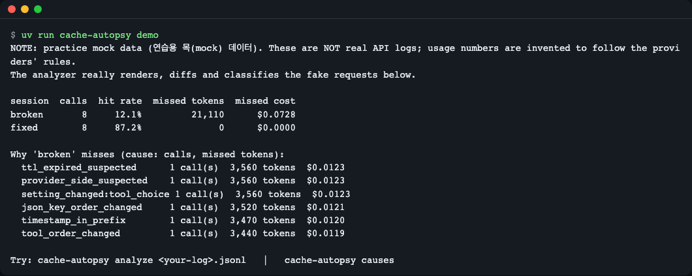
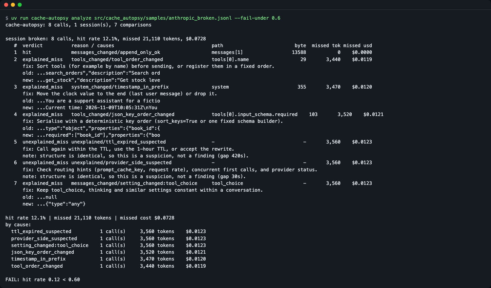
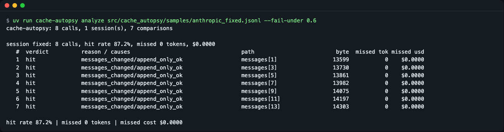
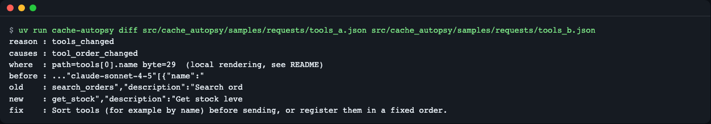
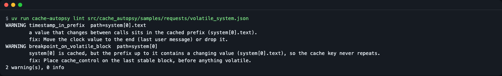
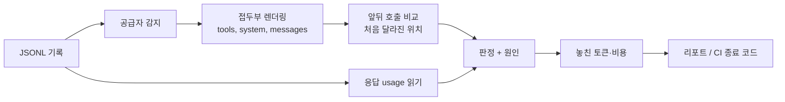

# cache-autopsy

[English](README.md) | **한국어**

프롬프트 캐시가 왜 깨졌는지, 이미 쌓아 둔 요청·응답 기록만으로 알려 주는 오프라인 CLI입니다. 공급자 콘솔을 뒤지거나 두 요청 본문을 눈으로 비교하는 수고를 줄여 줍니다.

```text
session  calls  hit rate  missed tokens  missed cost
broken       8     12.1%         21,110      $0.0728
fixed        8     87.2%              0      $0.0000
```
*`cache-autopsy demo` 의 실제 출력. 같은 대화를 고치기 전(broken)과 후(fixed)로 비교한 연습용 목(mock) 데이터입니다.*


*그림 1. `cache-autopsy demo` 실행 화면.*

> 아래 모든 출력은 실제로 실행해 복사한 것입니다.

## 이런 분께
- 오류는 없는데 입력 토큰 비용이 늘어서 원인을 찾아야 할 때
- 프롬프트·도구 정의를 바꾸는 PR에서 "캐시가 깨지지 않는지" CI로 막고 싶을 때
- "고정 프롬프트인데 `cached_tokens` 가 0" 같은 질문에 근거를 대야 할 때

## 설치
전제: Python 3.12 이상(3.12.4, 3.15.2 에서 테스트), [uv](https://docs.astral.sh/uv/), git. 의존 패키지는 없습니다.

```bash
curl -LsSf https://astral.sh/uv/install.sh | sh   # uv 가 없다면
git clone https://github.com/LeeGyeongPil/cache-autopsy.git
cd cache-autopsy
uv sync
uv run cache-autopsy --version
```
```text
cache-autopsy 0.1.1
```
최소 리눅스 컨테이너라면 `git`, `curl`, `ca-certificates` 가 필요합니다. PyPI 에는 아직 게시하지 않았습니다.

## 빠르게 시작하기
```bash
uv run cache-autopsy demo
```
```text
NOTE: practice mock data (연습용 목(mock) 데이터). These are NOT real API logs; usage numbers are invented to follow the providers' rules.
The analyzer really renders, diffs and classifies the fake requests below.

session  calls  hit rate  missed tokens  missed cost
broken       8     12.1%         21,110      $0.0728
fixed        8     87.2%              0      $0.0000

Why 'broken' misses (cause: calls, missed tokens):
  ttl_expired_suspected      1 call(s)  3,560 tokens  $0.0123
  provider_side_suspected    1 call(s)  3,560 tokens  $0.0123
  setting_changed:tool_choice 1 call(s)  3,560 tokens  $0.0123
  json_key_order_changed     1 call(s)  3,520 tokens  $0.0121
  timestamp_in_prefix        1 call(s)  3,470 tokens  $0.0120
  tool_order_changed         1 call(s)  3,440 tokens  $0.0119

Try: cache-autopsy analyze <your-log>.jsonl   |   cache-autopsy causes
```
- **hit rate**: 입력 토큰 중 캐시에서 읽은 비율입니다.
- **missed tokens / cost**: 캐시가 맞았다면 싸게 읽었을 토큰과, 그 차액(예시 단가 기준)입니다.
- 아래 줄은 "깨진 원인별" 합계입니다. 숫자는 연습용 목 데이터라서 실제 서비스 값이 아닙니다.

### 연습용 목(mock) 모드란
`demo` 와 `src/cache_autopsy/samples/` 의 로그는 `scripts/make_samples.py` 가 만든 **가짜 요청**입니다. 분석기는 이 요청 본문을 실제로 직렬화·비교·분류하므로 샘플 요청을 고치면 결과가 바뀝니다. 다만 응답의 `usage` 숫자는 공급자 규칙을 따르도록 지어낸 값입니다. 실제 로그를 넣으면 응답의 `usage` 를 그대로 읽습니다. 이 도구는 API 를 호출하지 않으므로 키가 필요 없고 느려질 일도 없습니다.

## 캐시 규칙 한눈에
확인일 2026-11-09. 모델·숫자는 자주 바뀌므로 아래 공식 문서가 기준입니다.

| | Anthropic | OpenAI |
|---|---|---|
| 접두부 순서 | tools → system → messages | 요청 앞부분이 같아야 함(암묵 캐시) |
| 최소 길이 | 모델별 512~4,096 토큰(미만이면 오류 없이 캐시 안 됨) | 1,024 토큰(모델별 차이 있음) |
| 유지 시간(TTL) | 5분(기본) 또는 1시간 | 모델별로 수십 분~24시간(옵션) |
| usage 필드 | `cache_read_input_tokens`, `cache_creation_input_tokens`, `input_tokens` | `input_tokens_details.cached_tokens` (Chat 은 `prompt_tokens_details`) |
| 적중률 분모 | read / (read + write + input) | cached / 전체 입력 토큰 |

Anthropic 의 `input_tokens` 는 마지막 캐시 지점 **뒤** 토큰만 세므로 `read / input_tokens` 로 계산하면 틀립니다. 출처: [Anthropic](https://platform.claude.com/docs/en/build-with-claude/prompt-caching), [OpenAI](https://developers.openai.com/api/docs/guides/prompt-caching).

## 사용법
| 명령 | 하는 일 | 종료 코드 |
|---|---|---|
| `demo` | 내장 연습 데이터로 전체 흐름을 보여 줌 | 0 |
| `analyze LOG.jsonl` | 적중률, 놓친 토큰·비용, 호출 쌍마다 판정과 원인 | 0, 게이트 실패 1, 입력 오류 2 |
| `diff A.json B.json` | 두 요청 본문에서 처음 달라진 지점 | 0 |
| `lint REQUEST.json` | 요청 하나에서 캐시를 깰 만한 패턴 | 경고 있으면 1 |
| `causes` | 원인 코드와 고치는 법 목록 (`--format md` 가능) | 0 |

주요 옵션: `--format text|json|md`, `--fail-under 0.6`(적중률 하한, **0~1 비율**이며 60 처럼 쓰면 종료 2), `--fail-on CODE,...`(해당 판정·원인이 있으면 실패, 모르는 값은 종료 2), `--session-key request.metadata.user_id`(대화 묶음 기준), `--pricing FILE`(단가 덮어쓰기), `--redact`(요청 텍스트를 출력하지 않음), `--provider`(자동 감지 대신 지정), `--min-tokens`(캐시 최소 토큰 수, 기본 1024).

### 입력 형식
한 줄에 JSON 객체 하나(파일 앞의 UTF-8 BOM 은 허용). `request`(필수), `response`(보통), `session_id`, `ts`(ISO-8601 또는 epoch 초)를 둡니다. 지원: Anthropic Messages, OpenAI Chat Completions, OpenAI Responses.
```json
{"session_id": "s1", "provider": "anthropic", "ts": "2026-11-09T10:00:00+00:00",
 "request": {"model": "...", "tools": [], "system": "...", "messages": []},
 "response": {"usage": {"input_tokens": 12, "cache_creation_input_tokens": 3410, "cache_read_input_tokens": 0, "output_tokens": 20}}}
```

### 기록 남기는 법
이 도구의 입력은 이미 쌓인 기록입니다. 호출할 때마다 **보낸 요청 인자**와 **응답 객체**를 한 줄씩 JSONL 에 덧붙이세요. 두 SDK 모두 응답 객체에 `model_dump()` 가 있어 dict 로 바꿀 수 있습니다.
```python
import json, time

def append_record(path, session_id, request, response):
    line = {"session_id": session_id, "ts": time.time(),
            "request": request, "response": response.model_dump(mode="json")}
    with open(path, "a", encoding="utf-8") as f:
        f.write(json.dumps(line, ensure_ascii=False) + "\n")
```
사용 예(SDK 호출 형태는 공식 문서 기준이며, 이 레포는 SDK 를 설치하거나 호출해 보지 않았습니다):
```python
# Anthropic: kwargs 를 변수로 두고 같은 것을 기록
kwargs = dict(model="...", max_tokens=256, system="...", messages=[...])
resp = anthropic.Anthropic().messages.create(**kwargs)
append_record("recorded.jsonl", "chat-1", kwargs, resp)

# OpenAI (Chat Completions)
kwargs = dict(model="...", messages=[...])
resp = openai.OpenAI().chat.completions.create(**kwargs)
append_record("recorded.jsonl", "chat-1", kwargs, resp)
```
`response` 에 `usage` 가 들어 있어야 적중률을 계산할 수 있습니다. 아래는 위 `append_record` 로 가짜 `usage` 가 든 응답 객체를 두 줄 기록한 뒤 분석한 예시 출력입니다. 그 가짜 객체는 이 문서에 싣지 않았으므로 **모양을 보여 주는 연습용 숫자**이며, 직접 만든 기록에서는 숫자가 다르게 나옵니다. 같은 모양의 기록이 필요하면 `src/cache_autopsy/samples/` 의 샘플 파일을 보세요.
```bash
uv run cache-autopsy analyze recorded.jsonl --fail-under 0.6 --format md
```
```text
FAIL: hit rate 0.00 < 0.60
## cache-autopsy report

**Hit rate 0.0%** · missed 3,410 tokens · missed cost $0.0118

| session | # | verdict | reason / causes | path | byte | missed tokens | missed cost |
|---|---|---|---|---|---|---|---|
| s1 | 1 | unexplained_miss | unexplained/provider_side_suspected | messages[1] | 67 | 3,410 | $0.0118 |

| cause | calls | missed tokens | missed cost |
|---|---|---|---|
| provider_side_suspected | 1 | 3,410 | $0.0118 |
```
종료 코드 1. 두 번째 호출의 `usage` 를 캐시 읽기 0 으로 둔 가짜 값이라 미스로 나옵니다.

### 시나리오 1 — 지난 기록에서 깨진 원인 찾기
```bash
uv run cache-autopsy analyze src/cache_autopsy/samples/anthropic_broken.jsonl --fail-under 0.6
```
```text
FAIL: hit rate 0.12 < 0.60
cache-autopsy: 8 calls, 1 session(s), 7 comparisons

session broken: 8 calls, hit rate 12.1%, missed 21,110 tokens, $0.0728
   #  verdict          reason / causes                                  path                         byte  missed tok missed usd
   1  hit              messages_changed/append_only_ok                  messages[1]                 13588           0    $0.0000
   2  explained_miss   tools_changed/tool_order_changed                 tools[0].name                  29       3,440    $0.0119
      fix: Sort tools (for example by name) before sending, or register them in a fixed order.
      old: ...search_orders","description":"Search ord
      new: ...get_stock","description":"Get stock leve
   3  explained_miss   system_changed/timestamp_in_prefix               system                        355       3,470    $0.0120
      fix: Move the clock value to the end (last user message) or drop it.
      old: ...You are a support assistant for a fictio
      new: ...Current time: 2026-11-09T10:05:31Z\nYou 
   4  explained_miss   tools_changed/json_key_order_changed             tools[0].input_schema.required    103       3,520    $0.0121
   ...
   5  unexplained_miss unexplained/ttl_expired_suspected                -                               -       3,560    $0.0123
      note: structure is identical, so this is a suspicion, not a finding (gap 420s).
   6  unexplained_miss unexplained/provider_side_suspected              -                               -       3,560    $0.0123
      note: structure is identical, so this is a suspicion, not a finding (gap 30s).
   7  explained_miss   messages_changed/setting_changed:tool_choice     tool_choice                     -       3,560    $0.0123
...
```
명령의 종료 코드는 1 입니다(위 블록은 프로그램 출력만 담았고 종료 코드 줄은 포함하지 않습니다). (위 출력은 가독성을 위해 일부 줄을 `...` 로 줄였습니다. 전체는 직접 실행해 보세요.)

읽는 법:
1. 한 행은 "바로 앞 호출 → 이 호출"의 비교입니다. `hit` 는 앞부분이 그대로 이어졌다는 뜻입니다(새 메시지만 덧붙임).
2. `explained_miss` 는 요청 구조에서 원인을 찾았다는 뜻입니다. `path` 와 `byte` 가 처음 달라진 위치입니다.
3. `unexplained_miss` 는 구조는 같은데 캐시가 안 맞은 경우입니다. 호출 간격이 TTL(캐시 유지 시간)보다 길면 `ttl_expired_suspected`, 아니면 `provider_side_suspected` 로 **추측**만 하며 단정하지 않습니다.
4. 종료 코드 1 은 `--fail-under` 게이트 실패입니다. CI 가 이 코드로 멈춥니다. (stderr 의 `FAIL:` 줄이 먼저 보이는 것은 출력 버퍼 순서 때문입니다.)


*그림 2. 깨진 기록 분석과 --fail-under 실패.*

고친 뒤 같은 명령은 통과합니다.
```bash
uv run cache-autopsy analyze src/cache_autopsy/samples/anthropic_fixed.jsonl --fail-under 0.6
```
```text
session fixed: 8 calls, hit rate 87.2%, missed 0 tokens, $0.0000
...
hit rate 87.2% | missed 0 tokens | missed cost $0.0000
```
종료 코드 0.


*그림 5. 고친 기록은 통과(종료 코드 0).*

### 시나리오 2 — 두 요청을 비교하기
```bash
uv run cache-autopsy diff src/cache_autopsy/samples/requests/tools_a.json src/cache_autopsy/samples/requests/tools_b.json
```
```text
reason : tools_changed
causes : tool_order_changed
where  : path=tools[0].name byte=29  (local rendering, see README)
before : ..."claude-sonnet-4-5"[{"name":"
old    : search_orders","description":"Search ord
new    : get_stock","description":"Get stock leve
fix    : Sort tools (for example by name) before sending, or register them in a fixed order.
```
도구 목록이 같은데 순서만 바뀌었습니다. 캐시는 도구 → 시스템 → 메시지 순으로 앞에서부터 이어 붙인 접두부(prefix)를 쓰므로, 맨 앞의 도구가 달라지면 뒤 전부가 무효가 됩니다.


*그림 3. 도구 순서 변경 비교.*

### 시나리오 3 — 보내기 전에 점검(lint)
```bash
uv run cache-autopsy lint src/cache_autopsy/samples/requests/volatile_system.json
```
```text
WARNING timestamp_in_prefix  path=system[0].text
        a value that changes between calls sits in the cached prefix (system[0].text).
        fix: Move the clock value to the end (last user message) or drop it.
WARNING breakpoint_on_volatile_block  path=system[0]
        system[0] is cached, but the prefix up to it contains a changing value (system[0].text), so the cache key never repeats.
        fix: Place cache_control on the last stable block, before anything volatile.
2 warning(s), 0 info
```
경고가 있어 종료 코드는 1입니다. 문제없는 `requests/clean.json` 은 `no findings: ...` 와 종료 코드 0 입니다.


*그림 4. 시간값이 접두부에 있다는 경고.*

### 시나리오 4 — 파이썬에서 부르기
```bash
uv run python examples/api_example.py
```
```text
0.12101639576974944 21110
hit ['append_only_ok'] messages[1]
explained_miss ['tool_order_changed'] tools[0].name
explained_miss ['timestamp_in_prefix'] system
tools_changed ['tool_order_changed'] tools[0].name 29
```
공개 함수는 `analyze_records(records)`, `diff_requests(a, b)`, `lint_request(req)` 세 개입니다([examples/api_example.py](examples/api_example.py)).

### CI에 넣기
프롬프트·도구 정의를 바꾸는 PR 에서 캐시 회귀를 막는 예시입니다. 종료 코드: **0** 통과, **1** 게이트 실패(적중률 하한 미달, `--fail-on` 해당, lint 경고), **2** 입력·옵션 오류(캐시 회귀가 아니므로 기록·옵션부터 고치세요).
```yaml
# .github/workflows/cache-gate.yml
name: cache-gate
on: pull_request
jobs:
  cache-gate:
    runs-on: ubuntu-latest
    steps:
      - uses: actions/checkout@v4
      - uses: astral-sh/setup-uv@v6
      - name: Lint the request template
        run: uvx --from git+https://github.com/LeeGyeongPil/cache-autopsy cache-autopsy lint tests/fixtures/request.json
      - name: Gate on recorded hit rate
        run: uvx --from git+https://github.com/LeeGyeongPil/cache-autopsy cache-autopsy analyze tests/fixtures/recorded.jsonl --fail-under 0.6 --format md
```
이 레포의 CI([.github/workflows/ci.yml](.github/workflows/ci.yml))는 같은 게이트(`analyze ... --fail-under 0.6 --format md`)를 동봉 샘플에 실행합니다. 위 예시의 `uvx --from git+...` 줄은 레포가 공개되기 전이라 아직 실행해 보지 못했습니다. `analyze`·`lint` 명령 자체는 위 시나리오에서 실행 확인했습니다.

pre-commit 훅으로 쓰려면 로컬 훅으로 같은 명령을 겁니다.
```yaml
# .pre-commit-config.yaml
repos:
  - repo: local
    hooks:
      - id: cache-autopsy-lint
        name: cache-autopsy lint
        entry: uvx --from git+https://github.com/LeeGyeongPil/cache-autopsy cache-autopsy lint
        language: system
        files: ^prompts/.*\.json$
```
이 훅도 공개 전이라 실행 확인 전입니다. 전용 Action·훅 배포 형태는 아래 로드맵 M2 입니다.

### 입력 오류
```bash
uv run cache-autopsy analyze nope.jsonl
```
```text
error: file not found: nope.jsonl. Check the path.
```
종료 코드 2. JSON 이 깨진 줄은 줄 번호와 함께 보고됩니다. UTF-8 이 아닌 파일, 디렉터리, 잘못된 `--fail-under`·`--fail-on` 값도 traceback 없이 고칠 방법과 함께 종료 코드 2 로 끝납니다.
```bash
uv run cache-autopsy analyze x.jsonl --fail-under 60
```
```text
error: --fail-under must be a ratio between 0 and 1 (got 60.0). Write 0.6 for 60%.
```

## 설정
- 환경변수·키·네트워크가 없습니다(`.env` 불필요).
- **단가**: `src/cache_autopsy/pricing.json` 에 모델별 예시 단가(USD / 1M 토큰)가 들어 있습니다. 파일 메타(`_meta`)에 `unverified_example_prices: true`(검증되지 않은 예시 단가), `carried_over: 2026-11-09`(이 날짜의 값을 옮겨 둠)와 출처([Anthropic](https://platform.claude.com/docs/en/about-claude/pricing), [OpenAI](https://developers.openai.com/api/docs/pricing))가 적혀 있지만, **이 값들은 개발 중 공식 가격 페이지와 다시 대조하지 못했습니다.** 그러니 "예시 단가"로 보고, 실제 청구와 맞춰 보려면 `--pricing my-prices.json`(같은 모양)으로 덮어쓰세요. 모르는 모델은 비용을 계산하지 않고 `unpriced_models` 로 알립니다.
- 응답에 `usage` 가 없으면 글자 수/4 로 토큰을 추정하고 결과에 추정임을 표시합니다.
- 바이트 위치와 JSON 경로는 문서에 적힌 섹션 순서를 따라 로컬에서 다시 그린 결과이며, 공급자 내부 직렬화와 같다는 보장은 없습니다.

## 동작 원리

1. 기록을 읽고 Anthropic·OpenAI 형식을 자동 감지합니다.
2. 요청을 캐시가 보는 순서(도구, 시스템, 메시지)로 이어 붙여 접두부를 만듭니다.
3. 같은 대화의 앞뒤 호출을 비교해 처음 달라지는 바이트와 JSON 경로를 찾고, 원인 규칙(도구 순서, 타임스탬프, 키 순서, 설정 변경 등)에 대 봅니다.
4. 응답 `usage` 의 캐시 읽기·쓰기 토큰으로 실제 적중 여부를 확인해 `hit` / `explained_miss` / `unexplained_miss` 를 정합니다.
5. 놓친 토큰에 단가 차액을 곱해 비용을 내고, 게이트 조건에 따라 종료 코드를 정합니다.

원인 코드 전체: [docs/causes.md](docs/causes.md). 샘플 재생성: `uv run python scripts/make_samples.py`.

## 다른 도구와 비교
| | cache-autopsy | 공급자 콘솔·사용량 대시보드 | 공급자 공식 진단 | 직접 diff |
|---|---|---|---|---|
| 오프라인·키 불필요 | 예 | 아니오(로그인 필요) | 아니오(요청 때 옵션을 켜야 함) | 예 |
| 이미 쌓인 기록 소급 분석 | 예 | 집계만 | 아니오(켠 뒤 요청부터) | 예 |
| 깨진 위치(경로·바이트) | 예 | 아니오 | 공급자가 알려 주는 사유 | 눈으로 찾아야 함 |
| 요청 구조 + usage 교차 확인 | 예 | usage 만 | 공급자 쪽 정보 | 아님 |
| CI 게이트 | 예 | 아니오 | 직접 구현 | 직접 구현 |
| 실제 청구액 | 단가 추정 | 정확함 | 아님 | 아님 |

**공식 진단과의 관계**: Anthropic 의 [cache diagnostics](https://platform.claude.com/docs/en/build-with-claude/cache-diagnostics), OpenAI 의 [prompt cache diagnostics](https://developers.openai.com/api/docs/guides/prompt-caching/diagnostics)를 대체하려는 것이 아니라, 이미 저장된 기록을 오프라인으로 분석하는 보완입니다. 기록 응답에 진단 필드가 들어 있으면 리포트에 `provider says: ... (agree=True|False)` 줄로 같이 보여 주어, 로컬 추정과 공급자 설명을 교차 확인할 수 있습니다.

**같은 주제의 다른 오픈소스 도구**: 캐시 적중 로그를 보는 작은 도구들이 있습니다(예: [prefixcash](https://pypi.org/project/prefixcash/), [cachelens](https://pypi.org/project/cachelens/), [prompt-cache-doctor](https://github.com/Ankitajainkuniya/prompt-cache-doctor)). 개발 중 조사한 바로는 공급자 하나만 지원하거나 도구 순서·설정 필드 변화·JSON 경로·CI 종료 코드까지는 다루지 않는 경우가 있었습니다(2026-11-09 확인, 이후 바뀌었을 수 있습니다). 각자 용도에 맞는 것을 고르세요.

정확한 청구 금액은 공급자 콘솔이 낫습니다. 이 도구의 금액은 예시 단가로 계산한 추정치입니다. 이 표는 이 도구 개발 중 조사한 일반적 차이이며, 개별 서비스를 일일이 평가한 것은 아닙니다.

## 자주 겪는 문제
| 증상 | 원인 | 해결 |
|---|---|---|
| `error: ... each record must be an object with a "request"` | 줄마다 `request` 키가 있어야 함 | 한 줄에 `{"request": {...}, "response": {...}}` 형태로 저장 |
| `cannot apply --fail-under: the log has no usage data.` (종료 2) | 응답에 usage 가 없음 | 응답 전체(또는 usage)를 같이 기록 |
| 구조는 같은데 `unexplained_miss` | TTL 만료, 첫 호출 동시 실행, 공급자 라우팅 등 | 출력의 `gap` 과 `fix` 를 보고 간격·`prompt_cache_key` 점검 |
| 비용이 `$0` 이거나 비어 있음 | 단가표에 없는 모델 | `--pricing` 으로 단가 추가 |
| 적중률이 낮은데 원인이 없음 | 앞 프롬프트가 캐시 최소 토큰 수보다 짧음 | `--min-tokens` 를 모델에 맞게 조정 |

## 더 알아보기
확인일 2026-11-09.
- Anthropic 프롬프트 캐싱: https://platform.claude.com/docs/en/build-with-claude/prompt-caching
- Anthropic 캐시 진단: https://platform.claude.com/docs/en/build-with-claude/cache-diagnostics
- OpenAI 프롬프트 캐싱 진단: https://developers.openai.com/api/docs/guides/prompt-caching/diagnostics

## 로드맵
현재는 M1(오프라인 분석기)입니다. 아래는 계획이며 약속이 아닙니다.
- **M2**: Gemini 입력(`usage.total_cached_tokens`), HAR·LiteLLM 로그 입력, 대화 자동 묶기, GitHub Action·pre-commit 훅 배포 형태, PyPI 게시 준비.
- **M3**: Python API 안정화와 테스트 도우미(`assert_prefix_stable` 같은 pytest 연동), 실제 키로 소량 녹화하는 선택 스크립트(`.env.example` 로 키 안내, 실제 모드는 공급자 상태에 따라 느릴 수 있음).

## 개발·기여
```bash
uv run pytest -q
uv run python -I -m unittest discover -s tests
```
```text
41 passed in 0.29s
```
버그·제안은 이슈로 남겨 주세요. 변경 기록은 [CHANGELOG.md](CHANGELOG.md).

## 라이선스
MIT. 샘플 데이터는 이 레포가 만든 가상의 서점 대화이며 실제 API 응답이 아닙니다.
