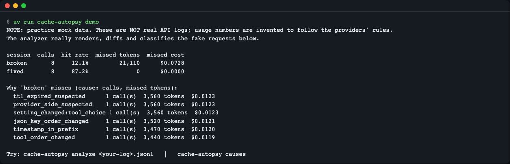
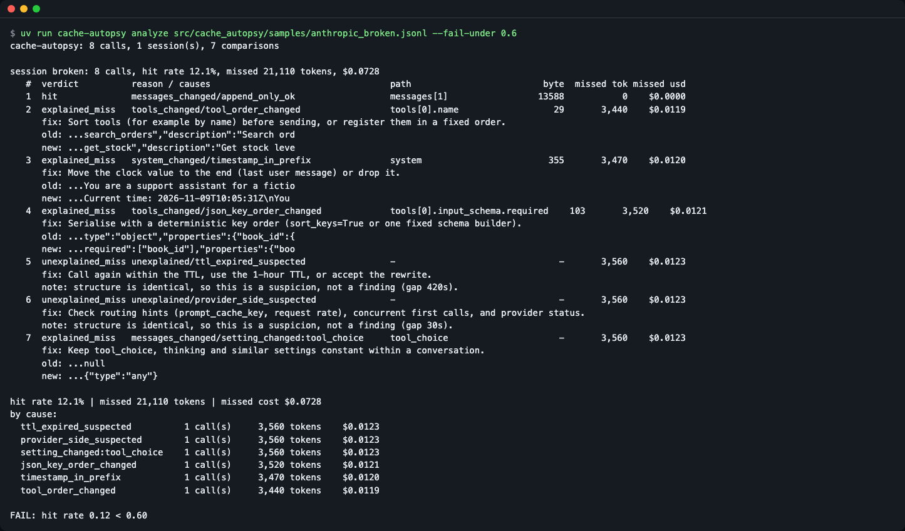
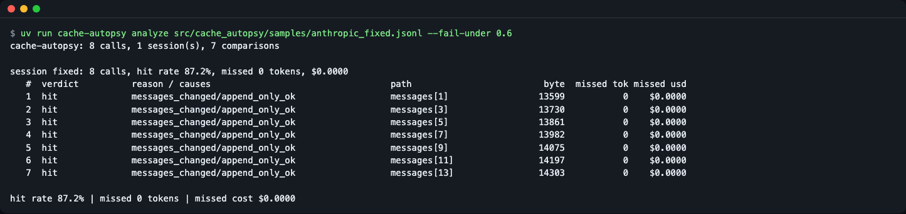
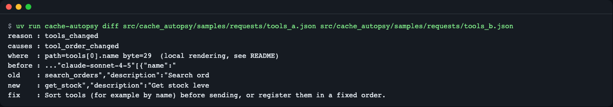
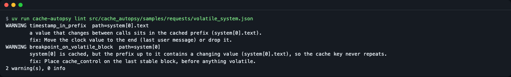
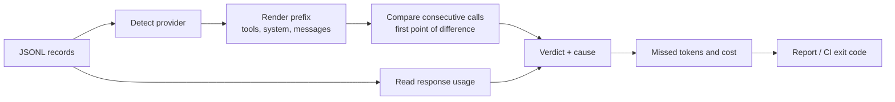

# cache-autopsy

**English** | [한국어](README.ko.md)

cache-autopsy reads your saved LLM request/response logs (JSONL) and tells you, offline, why the prompt cache missed: which request, which JSON path and byte offset diverged, what it cost, and how to fix it. It saves you from digging through the provider console or comparing two request bodies by eye. It is for developers calling the Anthropic or OpenAI APIs directly who want to explain a bill or gate prompt changes in CI. Run `uv run cache-autopsy demo` after cloning; no API key, no network, zero dependencies.

```text
session  calls  hit rate  missed tokens  missed cost
broken       8     12.1%         21,110      $0.0728
fixed        8     87.2%              0      $0.0000
```
*Real output of `cache-autopsy demo`. It compares the same conversation before (broken) and after (fixed) the fix, using practice mock data.*


*Figure 1. The `cache-autopsy demo` run screen.*

> All output below was actually run and copied.

## Who it is for
- When there are no errors but input-token costs have gone up and you need to find the cause
- When you want CI to block "does this break the cache?" on PRs that change prompts or tool definitions
- When you need evidence to answer questions like "the prompt is fixed, yet `cached_tokens` is 0"

## Installation
Prerequisites: Python 3.12 or later (tested on 3.12.4 and 3.15.2), [uv](https://docs.astral.sh/uv/), git. There are no dependency packages.

```bash
curl -LsSf https://astral.sh/uv/install.sh | sh   # if you do not have uv
git clone https://github.com/LeeGyeongPil/cache-autopsy.git
cd cache-autopsy
uv sync
uv run cache-autopsy --version
```
```text
cache-autopsy 0.2.0
```
On a minimal Linux container you need `git`, `curl` and `ca-certificates`. It has not been published to PyPI yet.

## Quick start
```bash
uv run cache-autopsy demo
```
```text
NOTE: practice mock data. These are NOT real API logs; usage numbers are invented to follow the providers' rules.
The analyzer really renders, diffs and classifies the fake requests below.

session  calls  hit rate  missed tokens  missed cost
broken       8     12.1%         21,110      $0.0728
fixed        8     87.2%              0      $0.0000

Why 'broken' misses (cause: calls, missed tokens):
  ttl_expired_suspected      1 call(s)  3,560 tokens  $0.0123
  provider_side_suspected    1 call(s)  3,560 tokens  $0.0123
  setting_changed:tool_choice 1 call(s)  3,560 tokens  $0.0123
  json_key_order_changed     1 call(s)  3,520 tokens  $0.0121
  timestamp_in_prefix        1 call(s)  3,470 tokens  $0.0120
  tool_order_changed         1 call(s)  3,440 tokens  $0.0119

Try: cache-autopsy analyze <your-log>.jsonl   |   cache-autopsy causes
```
The output language follows `--lang` / `CACHE_AUTOPSY_LANG` / your locale (`LANG`). If your shell locale is Korean, the same command prints Korean; add `--lang en` to match the block above (see [Configuration](#configuration)).

- **hit rate**: the share of input tokens that were read from the cache.
- **missed tokens / cost**: the tokens that would have been read cheaply from the cache had it hit, and the price difference (based on example prices).
- The lines below are totals "by cause of the break". The numbers are practice mock data, so they are not values from a real service.

### What practice mock mode is
The logs used by `demo` and in `src/cache_autopsy/samples/` are **fake requests** made by `scripts/make_samples.py`. The analyzer really serializes, compares and classifies these request bodies, so fixing a sample request changes the result. The `usage` numbers in the responses, however, are values invented to follow the providers' rules. When you feed in real logs, it reads the response `usage` as is. This tool does not call any API, so it needs no key and can never become slow.

## Cache rules at a glance
Checked on 2026-11-09. Models and numbers change often, so the official docs below are the reference.

| | Anthropic | OpenAI |
|---|---|---|
| Prefix order | tools → system → messages | The beginning of the request must be identical (implicit caching) |
| Minimum length | 512-4,096 tokens depending on the model (below that it is silently not cached, with no error) | 1,024 tokens (varies by model) |
| Retention (TTL) | 5 minutes (default) or 1 hour | Tens of minutes to 24 hours depending on the model (option) |
| usage fields | `cache_read_input_tokens`, `cache_creation_input_tokens`, `input_tokens` | `input_tokens_details.cached_tokens` (Chat uses `prompt_tokens_details`) |
| Hit-rate denominator | read / (read + write + input) | cached / total input tokens |

Anthropic's `input_tokens` counts only the tokens **after** the last cache breakpoint, so computing `read / input_tokens` is wrong. Sources: [Anthropic](https://platform.claude.com/docs/en/build-with-claude/prompt-caching), [OpenAI](https://developers.openai.com/api/docs/guides/prompt-caching).

## Usage
| Command | What it does | Exit code |
|---|---|---|
| `demo` | Shows the whole flow with built-in practice data | 0 |
| `analyze LOG.jsonl` | Hit rate, missed tokens and cost, and the verdict and cause for each call pair | 0, gate failure 1, input error 2 |
| `diff A.json B.json` | The first point where two request bodies differ | 0 |
| `lint REQUEST.json` | Patterns in a single request that are likely to break the cache | 1 if there are warnings |
| `causes` | A list of cause codes and how to fix them (`--format md` is available) | 0 |

Main options: `--format text|json|md` (`analyze` and `diff` accept all three; `causes` accepts `md`; `lint` prints text only and does not take `--format`), `--fail-under 0.6` (lower bound on hit rate; a **ratio from 0 to 1**, and writing it like 60 exits with 2), `--fail-on CODE,...` (fail if that verdict or cause is present; unknown values exit with 2), `--session-key request.metadata.user_id` (the basis for grouping a conversation), `--pricing FILE` (override prices), `--redact` (do not print request text), `--provider` (specify instead of auto-detecting), `--min-tokens` (minimum tokens for caching, default 1024).

### Input format
One JSON object per line (a UTF-8 BOM at the start of the file is allowed). Provide `request` (required), `response` (usually), `session_id`, and `ts` (ISO-8601 or epoch seconds). Supported: Anthropic Messages, OpenAI Chat Completions, OpenAI Responses.
```json
{"session_id": "s1", "provider": "anthropic", "ts": "2026-11-09T10:00:00+00:00",
 "request": {"model": "...", "tools": [], "system": "...", "messages": []},
 "response": {"usage": {"input_tokens": 12, "cache_creation_input_tokens": 3410, "cache_read_input_tokens": 0, "output_tokens": 20}}}
```

### How to record logs
This tool's input is records that have already accumulated. On every call, append the **request arguments you sent** and the **response object** to a JSONL file, one line each. Both SDKs have `model_dump()` on the response object, so it can be turned into a dict.
```python
import json, time

def append_record(path, session_id, request, response):
    line = {"session_id": session_id, "ts": time.time(),
            "request": request, "response": response.model_dump(mode="json")}
    with open(path, "a", encoding="utf-8") as f:
        f.write(json.dumps(line, ensure_ascii=False) + "\n")
```
Usage examples (the SDK call shapes follow the official docs; this repo has not installed or called the SDKs):
```python
# Anthropic: keep kwargs in a variable and record the same thing
kwargs = dict(model="...", max_tokens=256, system="...", messages=[...])
resp = anthropic.Anthropic().messages.create(**kwargs)
append_record("recorded.jsonl", "chat-1", kwargs, resp)

# OpenAI (Chat Completions)
kwargs = dict(model="...", messages=[...])
resp = openai.OpenAI().chat.completions.create(**kwargs)
append_record("recorded.jsonl", "chat-1", kwargs, resp)
```
The `response` must contain `usage` for the hit rate to be computed. Below is example output from analyzing two lines recorded with the `append_record` above, using response objects that hold fake `usage`. That fake object is not shown in this document, so these are **practice numbers that show the shape**; with records you make yourself, the numbers will differ. If you need records of the same shape, see the sample files in `src/cache_autopsy/samples/`.
```bash
uv run cache-autopsy analyze recorded.jsonl --fail-under 0.6 --format md
```
```text
FAIL: hit rate 0.00 < 0.60
## cache-autopsy report

**Hit rate 0.0%** · missed 3,410 tokens · missed cost $0.0118

| session | # | verdict | reason / causes | path | byte | missed tokens | missed cost |
|---|---|---|---|---|---|---|---|
| s1 | 1 | unexplained_miss | unexplained/provider_side_suspected | messages[1] | 67 | 3,410 | $0.0118 |

| cause | calls | missed tokens | missed cost |
|---|---|---|---|
| provider_side_suspected | 1 | 3,410 | $0.0118 |
```
Exit code 1. The second call's `usage` was set to a fake value with cache reads at 0, so it shows up as a miss.

### Scenario 1: finding why the cache broke in past logs
```bash
uv run cache-autopsy analyze src/cache_autopsy/samples/anthropic_broken.jsonl --fail-under 0.6
```
```text
FAIL: hit rate 0.12 < 0.60
cache-autopsy: 8 calls, 1 session(s), 7 comparisons

session broken: 8 calls, hit rate 12.1%, missed 21,110 tokens, $0.0728
   #  verdict          reason / causes                                  path                         byte  missed tok missed usd
   1  hit              messages_changed/append_only_ok                  messages[1]                 13588           0    $0.0000
   2  explained_miss   tools_changed/tool_order_changed                 tools[0].name                  29       3,440    $0.0119
      fix: Sort tools (for example by name) before sending, or register them in a fixed order.
      old: ...search_orders","description":"Search ord
      new: ...get_stock","description":"Get stock leve
   3  explained_miss   system_changed/timestamp_in_prefix               system                        355       3,470    $0.0120
      fix: Move the clock value to the end (last user message) or drop it.
      old: ...You are a support assistant for a fictio
      new: ...Current time: 2026-11-09T10:05:31Z\nYou 
   4  explained_miss   tools_changed/json_key_order_changed             tools[0].input_schema.required    103       3,520    $0.0121
   ...
   5  unexplained_miss unexplained/ttl_expired_suspected                -                               -       3,560    $0.0123
      note: structure is identical, so this is a suspicion, not a finding (gap 420s).
   6  unexplained_miss unexplained/provider_side_suspected              -                               -       3,560    $0.0123
      note: structure is identical, so this is a suspicion, not a finding (gap 30s).
   7  explained_miss   messages_changed/setting_changed:tool_choice     tool_choice                     -       3,560    $0.0123
...
```
The command's exit code is 1 (the block above contains only the program's output and does not include the exit-code line). (Some lines of the output above are shortened to `...` for readability. Run it yourself for the full output.)

How to read it:
1. One row is a comparison of "the previous call → this call". `hit` means the beginning continued unchanged (only new messages were appended).
2. `explained_miss` means the cause was found in the request structure. `path` and `byte` are the position where it first differs.
3. `unexplained_miss` is the case where the structure is the same but the cache did not match. If the gap between calls is longer than the TTL (cache retention time) it is `ttl_expired_suspected`, otherwise `provider_side_suspected`; these are only **guesses** and never asserted.
4. Exit code 1 is a `--fail-under` gate failure. CI stops on this code. (The `FAIL:` line on stderr appears first because of output buffering order.)


*Figure 2. Analysis of the broken log and the --fail-under failure.*

After the fix, the same command passes.
```bash
uv run cache-autopsy analyze src/cache_autopsy/samples/anthropic_fixed.jsonl --fail-under 0.6
```
```text
session fixed: 8 calls, hit rate 87.2%, missed 0 tokens, $0.0000
...
hit rate 87.2% | missed 0 tokens | missed cost $0.0000
```
Exit code 0.


*Figure 5. The fixed log passes (exit code 0).*

### Scenario 2: comparing two requests
```bash
uv run cache-autopsy diff src/cache_autopsy/samples/requests/tools_a.json src/cache_autopsy/samples/requests/tools_b.json
```
```text
reason : tools_changed
causes : tool_order_changed
where  : path=tools[0].name byte=29  (local rendering, see README)
before : ..."claude-sonnet-4-5"[{"name":"
old    : search_orders","description":"Search ord
new    : get_stock","description":"Get stock leve
fix    : Sort tools (for example by name) before sending, or register them in a fixed order.
```
The tool list is the same but only the order changed. The cache uses a prefix concatenated from the front in the order tools → system → messages, so when the first tool differs, everything after it is invalidated.


*Figure 3. Comparison of a tool order change.*

### Scenario 3: checking before sending (lint)
```bash
uv run cache-autopsy lint src/cache_autopsy/samples/requests/volatile_system.json
```
```text
WARNING timestamp_in_prefix  path=system[0].text
        a value that changes between calls sits in the cached prefix (system[0].text).
        fix: Move the clock value to the end (last user message) or drop it.
WARNING breakpoint_on_volatile_block  path=system[0]
        system[0] is cached, but the prefix up to it contains a changing value (system[0].text), so the cache key never repeats.
        fix: Place cache_control on the last stable block, before anything volatile.
2 warning(s), 0 info
```
There are warnings, so the exit code is 1. The problem-free `requests/clean.json` gives `no findings: ...` and exit code 0.


*Figure 4. A warning that a time value is in the prefix.*

### Scenario 4: calling it from Python
```bash
uv run python examples/api_example.py
```
```text
0.12101639576974944 21110
hit ['append_only_ok'] messages[1]
explained_miss ['tool_order_changed'] tools[0].name
explained_miss ['timestamp_in_prefix'] system
tools_changed ['tool_order_changed'] tools[0].name 29
```
There are three public functions: `analyze_records(records)`, `diff_requests(a, b)` and `lint_request(req)` ([examples/api_example.py](examples/api_example.py)).

### Putting it in CI
An example of blocking cache regressions on PRs that change prompts or tool definitions. Exit codes: **0** pass, **1** gate failure (hit rate below the lower bound, `--fail-on` matched, lint warnings), **2** input or option error (this is not a cache regression, so fix the records or options first).
```yaml
# .github/workflows/cache-gate.yml
name: cache-gate
on: pull_request
jobs:
  cache-gate:
    runs-on: ubuntu-latest
    steps:
      - uses: actions/checkout@v4
      - uses: astral-sh/setup-uv@v6
      - name: Lint the request template
        run: uvx --from git+https://github.com/LeeGyeongPil/cache-autopsy cache-autopsy lint tests/fixtures/request.json
      - name: Gate on recorded hit rate
        run: uvx --from git+https://github.com/LeeGyeongPil/cache-autopsy cache-autopsy analyze tests/fixtures/recorded.jsonl --fail-under 0.6 --format md
```
This repo's CI ([.github/workflows/ci.yml](.github/workflows/ci.yml)) runs the same gate (`analyze ... --fail-under 0.6 --format md`) on the bundled samples. The `uvx --from git+...` lines in the example above could not be run yet because the repo was not yet public. The `analyze` and `lint` commands themselves were verified by running them in the scenarios above.

To use it as a pre-commit hook, register the same command as a local hook.
```yaml
# .pre-commit-config.yaml
repos:
  - repo: local
    hooks:
      - id: cache-autopsy-lint
        name: cache-autopsy lint
        entry: uvx --from git+https://github.com/LeeGyeongPil/cache-autopsy cache-autopsy lint
        language: system
        files: ^prompts/.*\.json$
```
This hook has also not yet been verified by running, as the repo was not yet public. A dedicated Action and hook distribution is milestone M2 in the roadmap below.

### Input errors
```bash
uv run cache-autopsy analyze nope.jsonl
```
```text
error: file not found: nope.jsonl. Check the path.
```
Exit code 2. A line with broken JSON is reported with its line number. Non-UTF-8 files, directories, and invalid `--fail-under` or `--fail-on` values also end with exit code 2 and a way to fix them, with no traceback.
```bash
uv run cache-autopsy analyze x.jsonl --fail-under 60
```
```text
error: --fail-under must be a ratio between 0 and 1 (got 60.0). Write 0.6 for 60%.
```

## Configuration
- There are no keys or network (no `.env` needed).
- **Language**: human-readable output (help, tables, Markdown reports, errors, lint findings) comes in English or Korean. Pick it with `--lang en|ko` (before or after the subcommand) or the `CACHE_AUTOPSY_LANG` environment variable; otherwise `LC_ALL`, `LC_MESSAGES` and `LANG` are read in that order, and a value starting with `ko` means Korean. Anything else is English, including an unrecognized `CACHE_AUTOPSY_LANG` value (it does not fall through to the locale variables). Known limit: argparse's own built-in text (`usage:`, `positional arguments:`, `options:`, `-h, --help` and its usage errors such as `the following arguments are required`) stays English; only the tool's own help texts and messages are translated. For example `cache-autopsy --lang ko analyze log.jsonl` or `CACHE_AUTOPSY_LANG=ko cache-autopsy demo`. `--format json` output, cause codes, verdict values, `WARNING`/`ERROR`/`INFO` and exit codes are the same in both languages, so scripts and CI greps keep working.
- **Prices**: `src/cache_autopsy/pricing.json` holds example prices per model (USD / 1M tokens). The file metadata (`_meta`) states `unverified_example_prices: true` (unverified example prices), `carried_over: 2026-11-09` (the values were carried over on that date) and the sources ([Anthropic](https://platform.claude.com/docs/en/about-claude/pricing), [OpenAI](https://developers.openai.com/api/docs/pricing)), but **these values could not be re-checked against the official price pages during development.** So treat them as "example prices", and to match real bills override them with `--pricing my-prices.json` (same shape). For unknown models it does not compute a cost and reports them as `unpriced_models`.
- If a response has no `usage`, tokens are estimated as character count / 4, and the result marks that it is an estimate.
- Byte positions and JSON paths are the result of re-rendering locally following the section order described in the docs, and there is no guarantee they match the provider's internal serialization.

## How it works

1. It reads the records and auto-detects the Anthropic and OpenAI formats.
2. It concatenates the request in the order the cache sees it (tools, system, messages) to build the prefix.
3. It compares consecutive calls of the same conversation to find the first differing byte and JSON path, and matches it against the cause rules (tool order, timestamps, key order, setting changes, and so on).
4. It confirms the actual hit using the cache read and write tokens in the response `usage`, and decides `hit` / `explained_miss` / `unexplained_miss`.
5. It multiplies the missed tokens by the price difference to get the cost, and decides the exit code according to the gate conditions.

Full list of cause codes: [docs/causes.md](docs/causes.md). Regenerating samples: `uv run python scripts/make_samples.py`.

## Comparison with other tools
| | cache-autopsy | Provider console / usage dashboard | Provider's official diagnostics | Manual diff |
|---|---|---|---|---|
| Offline, no key needed | Yes | No (login required) | No (the option must be turned on at request time) | Yes |
| Retroactive analysis of existing records | Yes | Aggregates only | No (only requests after turning it on) | Yes |
| Location of the break (path, byte) | Yes | No | The reason the provider gives | You must find it by eye |
| Cross-check of request structure + usage | Yes | usage only | Provider-side information | No |
| CI gate | Yes | No | Build it yourself | Build it yourself |
| Actual billed amount | Estimated from prices | Exact | No | No |

**Relation to official diagnostics**: it is not meant to replace Anthropic's [cache diagnostics](https://platform.claude.com/docs/en/build-with-claude/cache-diagnostics) or OpenAI's [prompt cache diagnostics](https://developers.openai.com/api/docs/guides/prompt-caching/diagnostics); it complements them by analyzing already-stored records offline. If a recorded response contains diagnostic fields, the report shows them alongside as a `provider says: ... (agree=True|False)` line, so you can cross-check the local estimate against the provider's explanation.

**Other open-source tools on the same subject**: there are small tools that look at cache-hit logs (for example [prefixcash](https://pypi.org/project/prefixcash/), [cachelens](https://pypi.org/project/cachelens/), [prompt-cache-doctor](https://github.com/Ankitajainkuniya/prompt-cache-doctor)). From what was surveyed during development, some support only one provider, or do not go as far as tool order, setting-field changes, JSON paths or CI exit codes (checked 2026-11-09; this may have changed since). Pick the one that fits your purpose.

For exact billed amounts, the provider console is better. The amounts in this tool are estimates computed with example prices. This table describes general differences surveyed during this tool's development and is not an individual evaluation of each service.

## Troubleshooting
| Symptom | Cause | Fix |
|---|---|---|
| `error: ... each record must be an object with a "request"` | Each line must have a `request` key | Save each line in the form `{"request": {...}, "response": {...}}` |
| `cannot apply --fail-under: the log has no usage data.` (exit 2) | The response has no usage | Record the whole response (or the usage) as well |
| `unexplained_miss` although the structure is the same | TTL expiry, concurrent first calls, provider routing, etc. | Look at the `gap` and `fix` in the output, and check the interval and `prompt_cache_key` |
| The cost is `$0` or empty | The model is not in the price table | Add prices with `--pricing` |
| Hit rate is low but there is no cause | The leading prompt is shorter than the minimum cache token count | Adjust `--min-tokens` to the model |

## Learn more
Checked on 2026-11-09.
- Anthropic prompt caching: https://platform.claude.com/docs/en/build-with-claude/prompt-caching
- Anthropic cache diagnostics: https://platform.claude.com/docs/en/build-with-claude/cache-diagnostics
- OpenAI prompt caching diagnostics: https://developers.openai.com/api/docs/guides/prompt-caching/diagnostics

## Roadmap
It is currently M1 (the offline analyzer). The following is a plan, not a promise.
- **M2**: Gemini input (`usage.total_cached_tokens`), HAR and LiteLLM log input, automatic conversation grouping, GitHub Action and pre-commit hook distribution, PyPI publishing preparation.
- **M3**: Stabilizing the Python API and test helpers (pytest integration such as `assert_prefix_stable`), an optional script that records a small amount with real keys (key guidance via `.env.example`; real mode may be slow depending on the provider's state).

## Development and contributing
```bash
uv run pytest -q
uv run python -I -m unittest discover -s tests
```
```text
81 passed in 2.45s
```
Please leave bugs and suggestions as issues. The change log is [CHANGELOG.md](CHANGELOG.md).

## License
MIT. The sample data is a fictional bookstore conversation made by this repo and is not a real API response.
